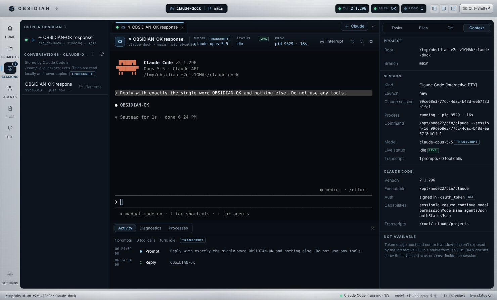

# OBSIDIAN

**A brushed-aluminum spacecraft terminal for Claude Code on macOS.**

OBSIDIAN is a desktop cockpit for the Claude Code CLI you already use. It runs your real
`claude` executable in a real terminal (xterm.js over a pseudo-terminal), so your subscription
login, permission prompts, slash commands and `/model` all work exactly as they do in Terminal.
Around that terminal it adds project navigation, git status and diffs, session history and resume,
live session status, an activity timeline, tasks, and a command palette.



> **Status:** built and tested end to end in a Linux x86_64 build container: 36 unit tests,
> 48 end-to-end checks against the real app, including a real authenticated Claude Code
> session. It has **not yet been run on macOS hardware**. The macOS pieces (traffic lights,
> hidden-inset title bar, SF fonts, node-pty's `darwin-arm64` prebuild, FSEvents file watching,
> DMG packaging) are configured but unverified. See [Known limitations](#known-limitations).

---

## Requirements

| | |
| --- | --- |
| Mac | Apple Silicon, macOS 12 or later (built with a MacBook Air / 16 GB in mind) |
| Node.js | 20 or newer, to build (`brew install node`, or the installer from nodejs.org) |
| Claude Code | installed and signed in. OBSIDIAN detects it automatically. |

**No Xcode needed.** node-pty 1.1 ships a prebuilt `darwin-arm64` binary that works in Electron without recompiling.
**No API key needed.** OBSIDIAN never asks for one and never touches your credentials.

### If Claude Code isn't installed or signed in yet

```bash
curl -fsSL https://claude.ai/install.sh | bash     # official installer, or:
npm install -g @anthropic-ai/claude-code
claude                                            # first run walks you through sign-in
claude auth status                                # should report "loggedIn": true
```

OBSIDIAN's **Mission Control** screen shows the same checks (CLI found, version, sign-in state)
and tells you exactly what's missing. You can do all of the above from a shell tab inside OBSIDIAN.

## Install and launch

```bash
git clone <this repo> && cd <repo>/obsidian
npm install          # also downloads Electron and fixes node-pty's helper permissions
npm start            # build + launch
```

Development mode, with the renderer on Vite's dev server:

```bash
npm run dev
```

### Build a Mac app

```bash
npm run package:mac   # → release/OBSIDIAN-0.1.0-arm64.dmg and a .zip
```

The build is **not signed with a Developer ID**. A copy you build yourself on your own Mac opens
normally. If you move it to another Mac and Gatekeeper blocks it, right-click → **Open** once.

## First flight

1. **Mission Control** opens with a pre-flight checklist: Claude Code detected → signed in → project opened.
2. **Open a project**: Projects → `+`, or <kbd>⌘O</kbd>. You choose a folder in the native dialog. OBSIDIAN never scans your disk on its own.
3. **Start a session**: <kbd>⌘T</kbd>. Claude Code starts in that folder. The first time in a new folder, Claude Code asks whether you trust it. That prompt belongs to Claude Code, and you answer it in the terminal.
4. **Work as usual.** Type in the terminal. <kbd>⇧↩</kbd> inserts a newline. <kbd>Esc</kbd> (or the **Interrupt** button) stops Claude mid-turn.

## What's on the panel

| Region | What it shows | Where the data comes from |
| --- | --- | --- |
| **Title bar gauges** | CLI version · sign-in · running processes | `claude --version`, `claude auth status --json`, OBSIDIAN's own process table |
| **Rail** | Home, Projects, Sessions, Agents, Files, Git, Settings | — |
| **Projects** | Recent folders, branch, change count, live-session LEDs | folders you opened, `git status` |
| **Sessions** | Open sessions, plus resumable conversations for the project | OBSIDIAN processes; Claude Code's own transcript folder (read-only) |
| **Agents** | Every active Claude session on the machine, plus your subagent definitions | `claude agents --json`; `.claude/agents/*.md` |
| **Tabs** | Claude Code, shell, file and diff tabs | — |
| **Session header** | Model · status · permission mode · pid/uptime, each labeled with its source | see "provenance labels" below |
| **Terminal** | The real CLI: input, selection, copy/paste, scrollback, find, resize | node-pty |
| **Composer** (optional) | Drafts long prompts and sends them as a paste followed by Return | writes to the same PTY |
| **Bottom panel** | Activity timeline · diagnostics log · process table | session transcript, OBSIDIAN events |
| **Tasks** | Claude's own todo list (when it makes one) plus your manual tasks | transcript `TodoWrite` calls; `tasks.json` |
| **Files** | Modified files, and files this session edited | `git status`; transcript |
| **Git** | Branch, ahead/behind, stage/unstage, discard (native confirm), commit | `git` |
| **Context** | Project root, session id, process, model, CLI, auth, capabilities | all of the above |

### Provenance labels

Every derived value carries a small tag showing where it came from:

- `LIVE`: reported just now by `claude agents --json`
- `TRANSCRIPT`: read from Claude Code's conversation file for this session
- `REQUESTED`: what OBSIDIAN asked for (e.g. `--model opus`), not yet confirmed by a reply
- `GIT` / `CLI`: direct output of `git` or `claude`
- `N/A`: not available. OBSIDIAN leaves it blank rather than guess.

OBSIDIAN doesn't show token counts, cost or context fill, because the interactive CLI doesn't expose
them in a stable form. Use `/status` or `/cost` inside the session.

## Keyboard

All shortcuts can be changed in **Settings → Shortcuts**. Every shortcut must include ⌘, so none of
them can take a key away from the terminal.

| | |
| --- | --- |
| <kbd>⌘T</kbd> / <kbd>⇧⌘T</kbd> | New Claude Code session / new shell |
| <kbd>⌘W</kbd> | Close tab (asks first if the process is still running) |
| <kbd>⌘1</kbd>…<kbd>⌘9</kbd>, <kbd>⇧⌘[</kbd> <kbd>⇧⌘]</kbd> | Switch tabs |
| <kbd>⇧⌘P</kbd> | Command palette (commands, sessions, projects) |
| <kbd>⌘P</kbd> | Quick-open a file |
| <kbd>⌘O</kbd> | Open project |
| <kbd>⌘B</kbd> / <kbd>⌥⌘B</kbd> / <kbd>⌘J</kbd> | Toggle navigator / intelligence panel / bottom panel |
| <kbd>⌘F</kbd> / <kbd>⌘K</kbd> | Find in / clear the terminal |
| <kbd>⌘=</kbd> / <kbd>⌘-</kbd> | Terminal font size |
| <kbd>⌘,</kbd> | Settings |

The palette also has **Continue most recent** (`claude --continue`), **Pick from history**
(`claude --resume`), **Plan-mode session**, **Interrupt**, and the layout presets.

## Safety model

- The renderer is sandboxed: context isolation on, no Node.js, strict CSP, navigation blocked, every permission request denied.
- The renderer can't name an executable or an arbitrary path. Projects and a custom `claude` path can only come from native file dialogs. File reads are confined to the project, even through symlinks.
- Sessions are built from structured requests. OBSIDIAN never passes `--dangerously-skip-permissions` or `bypassPermissions`, and the IPC layer rejects them even if asked.
- Discarding changes asks for confirmation in a **native** dialog, shown by the main process. OBSIDIAN never deletes untracked files.
- Closing a tab or quitting ends only processes OBSIDIAN started (SIGHUP, then SIGKILL after 3 s), and asks first while any are running.

Details: [docs/ARCHITECTURE.md](docs/ARCHITECTURE.md). Stored data: [docs/DATA.md](docs/DATA.md).

## Testing

```bash
npm run typecheck
npm test                                  # 36 unit tests (validation, argv, git, transcript, fs, store)
npm run build && npm run test:e2e         # drives the real Electron app with Playwright
OBSIDIAN_E2E_CLAUDE=0 npm run test:e2e    # skip the suite that sends one tiny real prompt
OBSIDIAN_E2E_BINARY=release/…/OBSIDIAN npm run test:e2e   # run against a packaged build
```

On Linux, wrap the e2e command in `xvfb-run -a`. The latest results are in [docs/PROGRESS.md](docs/PROGRESS.md#test-results).

## Known limitations

- **Not yet run on a Mac.** Everything Mac-specific is configured but unverified on real hardware (see the status note at the top). If something misbehaves, **Help → Show Diagnostics** shows what happened.
- **Model and activity come from Claude Code's transcript files**, an internal format that can change between versions. When it does, those fields show `N/A`. The session itself is unaffected.
- **Live status** needs a Claude Code version with `claude agents --json`. OBSIDIAN polls it every 8 s, and only while a Claude session is open and the window is visible (~0.3 s CPU per poll). You can turn it off in Settings.
- **Resume** works for conversations Claude Code has saved. A session closed before its first prompt has nothing to resume.
- **Colors inside the terminal** are Claude Code's own. 24-bit colors it emits bypass OBSIDIAN's palette.
- **One window.** Tabs are independent processes. There's no split-pane terminal yet.
- **The file viewer is read-only, with no syntax highlighting**, to stay lightweight. Edits happen through Claude or your editor.
- **No auto-update and no code signing.**

## Troubleshooting

| Symptom | Fix |
| --- | --- |
| "Claude Code executable not found" | Settings → Claude Code → **Choose…** and pick your `claude` (often `~/.local/bin/claude`) |
| Session exits immediately | Read the banner and the terminal output. Usually it's sign-in (`claude auth login` in a shell tab) |
| `posix_spawnp failed` | Run `npm install` again, or `chmod +x node_modules/node-pty/prebuilds/darwin-arm64/spawn-helper` |
| Warning about `ANTHROPIC_API_KEY` | That variable is set in the environment OBSIDIAN inherits, so Claude Code may bill the key instead of your subscription. Unset it if that isn't what you want |
| UI glitch | Each panel has its own error boundary with **Reload interface**. Running sessions survive a reload |
